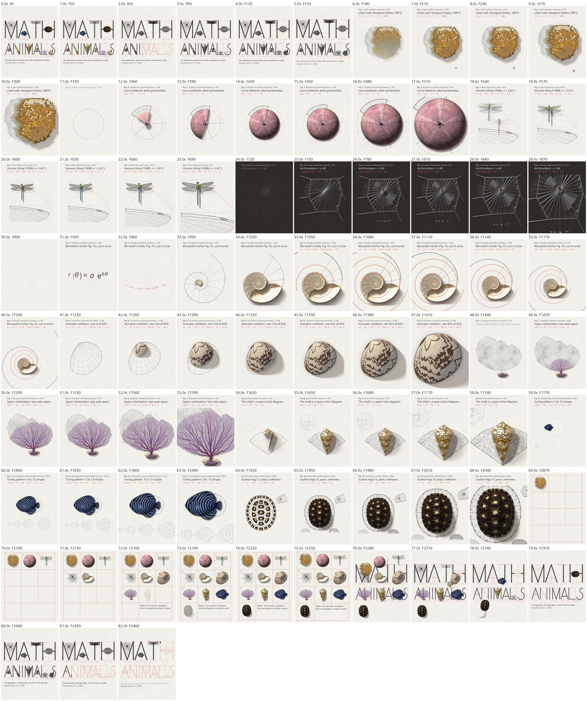
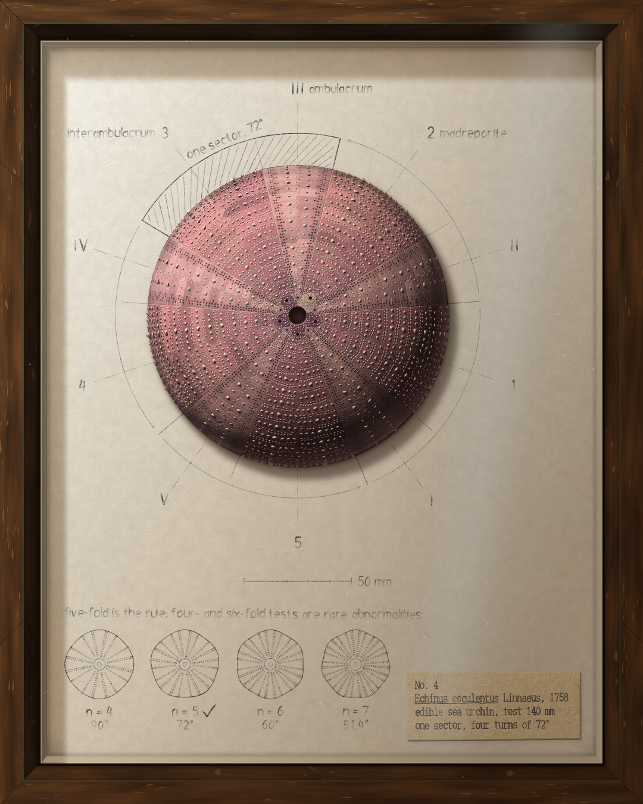
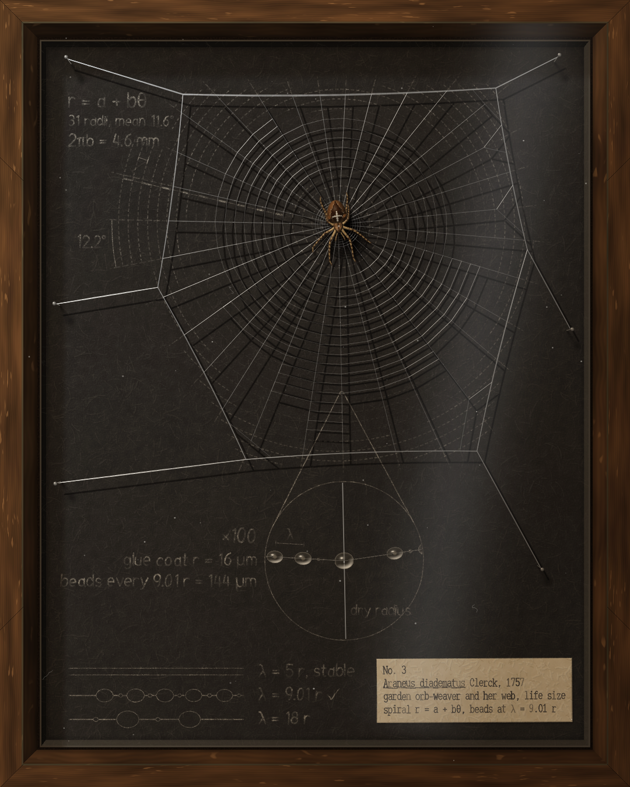
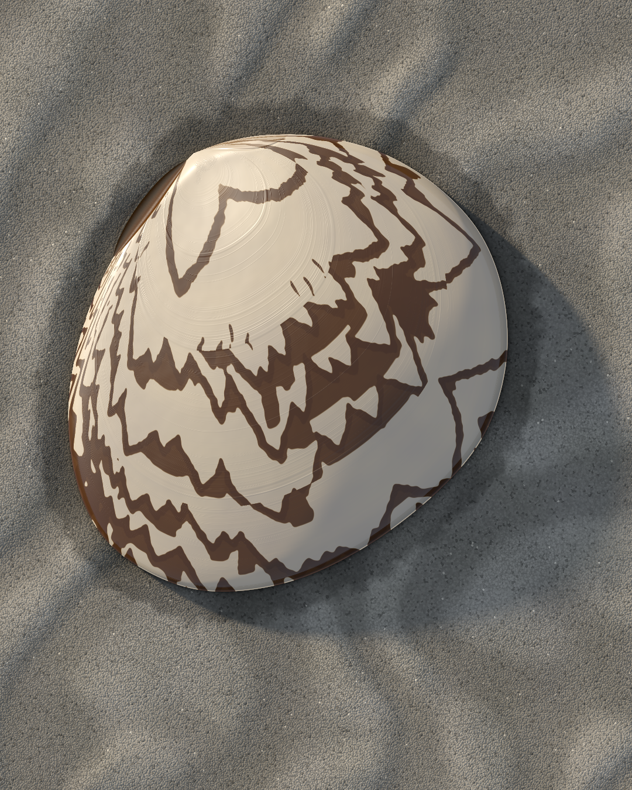
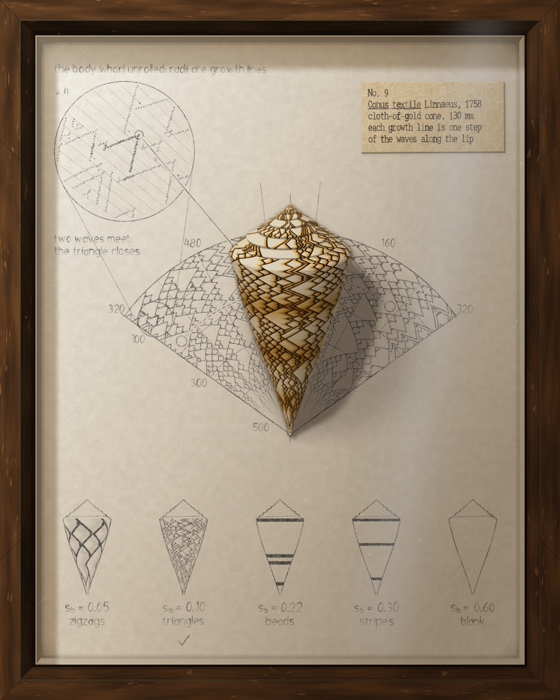
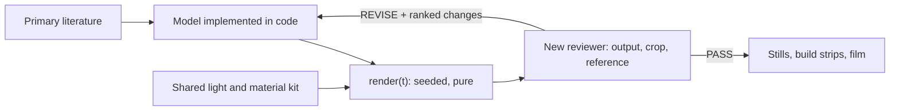

# Computed form: Claude making art from the rules that shape living things



| | | | | |
|---|---|---|---|---|
|  |  |  |  |  |
| Fig. 1 Honeybee | Fig. 2 Sea urchin | Fig. 3 Dragonfly | Fig. 4 Orb-weaver | Fig. 5 Nautilus |
|  |  |  |  |  |
| Fig. 6 Camp pitar | Fig. 7 Sea fan | Fig. 8 Cone shell | Fig. 9 Angelfish | Fig. 10 Tortoise |

Claude (Opus 5.5) can take a published scientific model of how an animal's form arises, implement it, and render the result as finished artwork with no image files. It also directed, built and reviewed the work itself, running unattended for hours. The technique is general: the picture is the model's output, and the model's construction stays visible in it. The test set is the ten animals in an 82-second film, drawn by 15,227 lines of code. Each form is drawn by its cited rule. Reviewers still identify the surfaces as computed, and only the dragonfly passed review.

## The technique

1. **The rule generates the image.** Choose a peer-reviewed model of the form (a growth law, a pattern-forming equation, a tiling). Implement it, and render its output directly.
2. **The construction is part of the image.** Draw the computation (the field, the lattice, the seed points) in register with the form it produces, so a viewer can check the picture against the rule.
3. **The render is a pure, seeded function of time.** `render(t)` draws one frame from a hashed seed and nothing else. This makes animation, frame-exact film, regression checks and reproducible output possible without extra work.
4. **One shared material and light kit.** A single shading library (soft area light, occlusion, scattering, reflections blurred by roughness) is inlined into every piece, so the set reads as one body of work.
5. **Every number has a source.** Each parameter and caption comes from a primary source and is cited in the frame. A value without a source is cut.
6. **The maker does not judge its own work.** Each round, a new reviewer sees only fixed inputs (the output at feed size, one crop, one reference) and returns a verdict with up to three ranked changes.



## The ten animals and their rules

| Animal | Rule that draws it |
|---|---|
| Chambered nautilus | Logarithmic spiral, W = 3.00 a whorl |
| Honeybee comb | Honeycomb theorem (Hales, 2001): circles relax into hexagons |
| Garden orb-weaver | Archimedean spiral; glue beads at the Rayleigh–Plateau wavelength |
| Edible sea urchin | Dihedral symmetry D5: one sector and its four rotations |
| Emperor dragonfly | Voronoi tiling of the wing, n = 2,611 cells |
| Sea fan | Space colonisation: branch tips grow toward free space |
| Camp pitar | Meinhardt's shell-pattern model, row by row |
| Textile cone | Activator–inhibitor pigment, recorded as a space-time diagram |
| Semicircle angelfish | Turing reaction–diffusion, after Kondo and Asai (1995) |
| Radiated tortoise | Accretion growth: ring k = areola × (1 + 0.352 k) |

## What Claude does in it

| Ability | Evidence |
|---|---|
| Reads and implements primary science | Ten published models, each fact in the film's captions checked against a primary source. |
| Writes numerical methods for the browser | Reaction–diffusion, Voronoi tilings, activator–inhibitor systems, space colonisation and area-light shading, each in one Canvas 2D page. |
| Art direction to a written bar | Concept card, concept frames and a blind read against a seven-word design bar, all before any code. |
| Orchestration | A lead writes one brief and one card per animal, parallel builders implement them, and new reviewers judge each round. Runs last up to 8.5 hours unattended on a remote desktop. |
| Film from computed pages | Each chapter is shot from a copy of its page at 3x resolution. The camera zooms about the animal's measured centre, which stays fixed within 0.004 px. |
| Measures its own output | Determinism checks, frame-difference checks for still frames, line counts and motion profiles, reported with each result. |

## Results

- **Contract:** all ten pages are blank at t = 0, built by 4.5 s and deterministic, and none uses an image file.
- **Form:** each animal is drawn by its cited rule, and the construction stays on the page.
- **Material:** nine of the ten were reviewed in the first series. One passed (the dragonfly), and the other eight ended on REVISE after four to six rounds, mostly because the pencil was too faint at feed size and the surfaces looked computed. The same nine then went through a round on material realism, and all 45 reviews in that round returned REVISE.

## Where it applies

Any form with a published generative model: shells and horns, phyllotaxis, crystals, river and vein networks, cracks, coat and pigment patterns. Each result can be checked against its source, line by line, which images from generative models cannot.

## Open problems

- **Material realism:** computed shell, pigment and membrane are still recognised as computed. The next step is to sample material statistics from reference photographs, beyond their palettes.
- **Review signal:** reviewers who see only the output rarely return PASS. A score per criterion would show progress between rounds more clearly than PASS or REVISE.

## This repository

- `NN-name/index.html`: one page per animal, self-contained (open it in a browser). `NN-name/NOTES.md` gives the mathematics, its sources and the trials behind each page.
- `out/`: each page's finished frame at 5.2 s, 1080 × 1350.
- `kit/`: the shared light and material kit, inlined into every page by `node kit/sync.mjs <page.html>`.
- `CONCEPT.md`: the concept card and the concept frames considered (`concept-frames/`). It describes the first series of ten, in which a glass sponge held the place the camp pitar holds in the film.
- `BUILDERS.md`: the brief each builder worked from.
- `tools/render.mjs`: renders a page at given times and checks it is deterministic.

```
cd tools && npm install
node render.mjs ../01-nautilus/index.html /tmp/nautilus 0,1.5,3,4.5,5.2
```

Math-Animals extends [tenfold](https://github.com/r3al1tym/tenfold), and its bar for craft is tenfold's `16-specimen` page. Every page and every line of code was written by Claude Opus 5.5. MIT licence.
