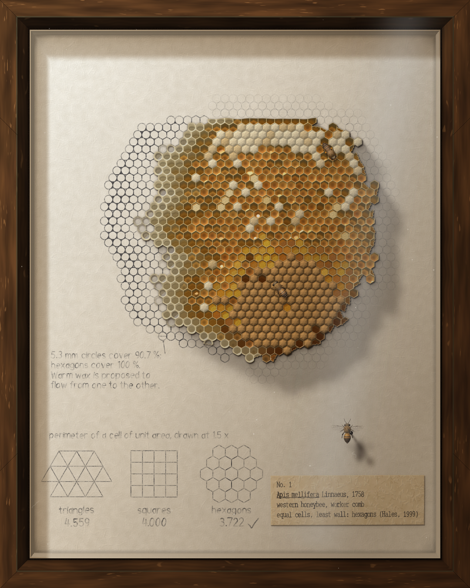
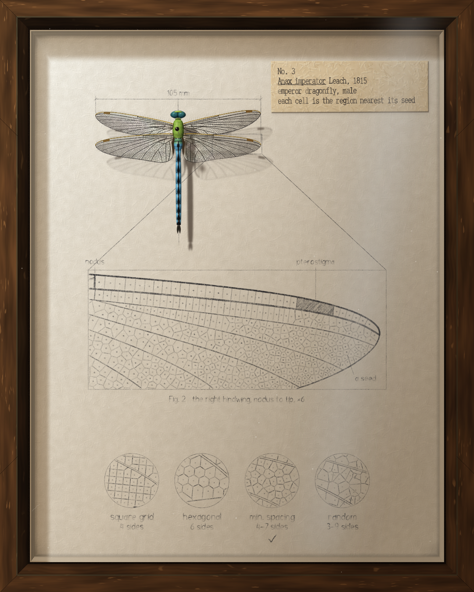
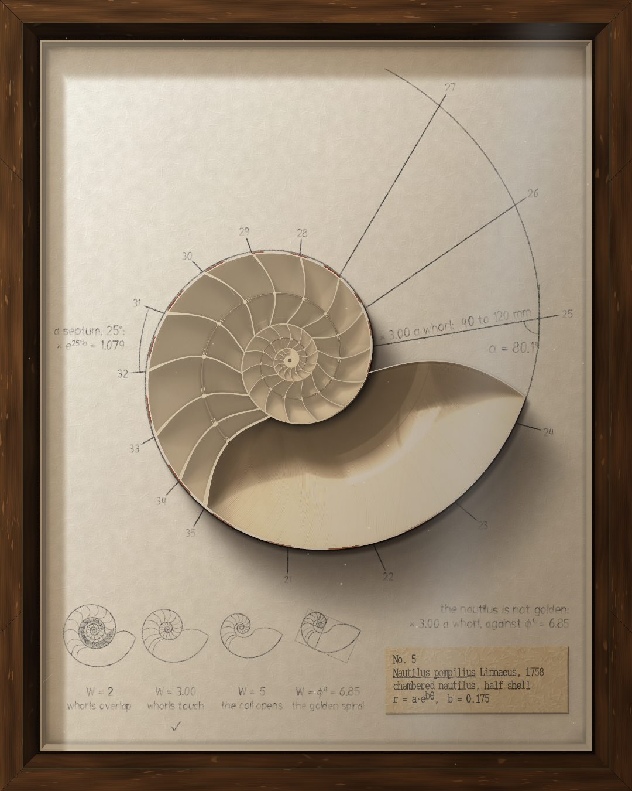
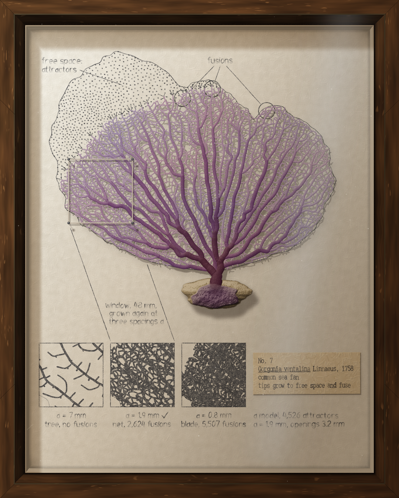
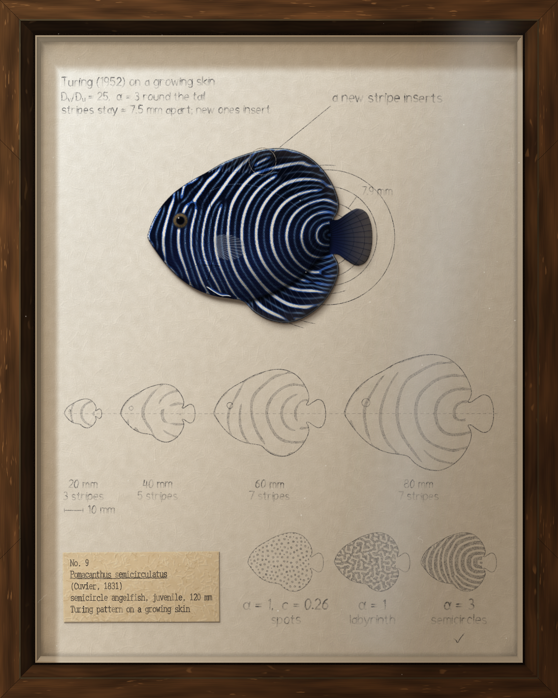
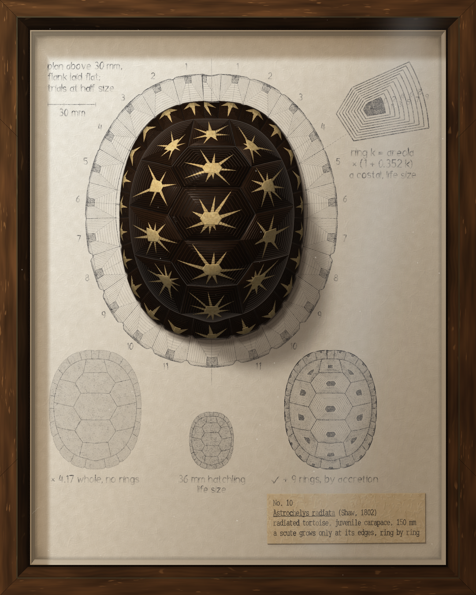
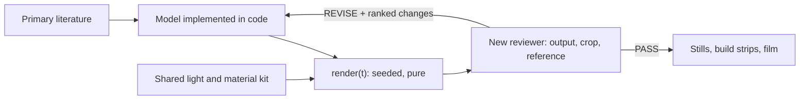

# Math-Animals

Claude read the science of how ten animals get their shape, implemented each published model, and drew the animal from it. Each animal is one HTML page of Canvas 2D code with no image files: 15,227 lines in all, every line written by Claude Opus 5.5, every number cited.

**[Open the site](https://r3al1tym.github.io/math-animals/)**: the dragonfly computes in your browser as you arrive, each plate faces the paper it was drawn from, and any plate grows from its rule when you click it. **[Watch the full film](https://r3al1tym.github.io/math-animals/film/)** (64 s, silent).

https://github.com/user-attachments/assets/3ce3b5e5-801b-4282-9f4f-9ab6795153e8

| | | | | |
|---|---|---|---|---|
|  |  |  |  |  |
| Fig. 1 Honeybee | Fig. 2 Sea urchin | Fig. 3 Dragonfly | Fig. 4 Orb-weaver | Fig. 5 Nautilus |
|  |  |  |  |  |
| Fig. 6 Camp pitar | Fig. 7 Sea fan | Fig. 8 Cone shell | Fig. 9 Angelfish | Fig. 10 Tortoise |

## What Claude read

Each builder session started from the research on its animal, implemented the model it describes, and drew the animal from the model's output. The construction stays on the page, so you can check the picture against the rule.

| Animal | Model Claude implemented | Research it read |
|---|---|---|
| Emperor dragonfly | Inhibitory centres spaced evenly between the main veins; walls form where their signals are weakest (a Voronoi tiling, 2,611 cells) | Hoffmann, Donoughe, Li, Salcedo and Rycroft, *PNAS* (2018), wing cells measured in 232 odonate species |
| Semicircle angelfish | Turing reaction–diffusion on a growing skin: stripes insert as the fish lengthens, 3 to 13 | Kondo and Asai, *Nature* 376 (1995); Painter, Maini and Othmer, *PNAS* (1999); Turing (1952) |
| Textile cone | Activator–inhibitor with a global hormone, one row per growth step, so the shell is a space-time diagram | Meinhardt and Klingler, *J. Theor. Biol.* 126 (1987), run as Meinhardt's own program for *Conus textile* |
| Camp pitar | Activator–inhibitor run along a lengthening mantle edge | Meinhardt, *The Algorithmic Beauty of Sea Shells* |
| Common sea fan | Space colonisation: branch tips grow toward 4,526 points of free space, plus a fusion rule | Runions et al. (2005, 2007) |
| Chambered nautilus | Logarithmic spiral r = a·e^(bθ), b = 0.175, so each whorl grows 3.00x: the nautilus is not golden | Moseley's whorl ratios; Bartlett (2018), 80 shells; Ward et al. (1981) |
| Garden orb-weaver | Archimedean capture spiral; glue beads at the Rayleigh–Plateau wavelength, 9.01 thread radii, which the page solves for | Rayleigh's instability of a liquid cylinder; Zschokke (1993, 2011); Opell and Hendricks (2007) |
| Honeybee comb | Hexagons use the least wall of any equal-area tiling; circles relax into hexagons | Hales, *Discrete & Computational Geometry* 25 (2001); Karihaloo, Zhang and Wang (2013) |
| Edible sea urchin | Dihedral symmetry D5: one sector of plates and its four rotations | Descriptions of the Echinidae test |
| Radiated tortoise | Growth by accretion: ring k = areola × (1 + 0.352k) | Keratin added only at the scute's edges |

Each page's `NOTES.md` gives the mathematics, the sources for every number and the trials behind it. Fact-checker sessions verified every caption in the film against a primary source.

## How Claude made it

Claude Code (Opus 5.5) wrote every line. I directed and gave notes.

- A lead session wrote the concept, one shared builder brief ([BUILDERS.md](BUILDERS.md)) and a card per animal: its rule, its sources, its moment.
- Ten builder sessions worked in parallel, one per animal, each reading its research and implementing the model.
- After every round, a new reviewer session that had never seen the work judged the rendered frame alone and returned PASS or REVISE with ranked changes.
- Fact-checker sessions verified every caption against a primary source.

154 Claude sessions in all (3 leads, 46 builders, 97 blind reviewers, 8 fact-checkers): about 92 agent-hours and 9,900 tool calls, with runs of up to 8.5 hours unattended on a remote desktop. The ten pages took about six and a half hours of wall-clock time, and the film went through 20 drafts on my notes.

## The technique

1. **The rule generates the image.** Choose a peer-reviewed model of the form (a growth law, a pattern-forming equation, a tiling). Implement it, and render its output directly.
2. **The construction is part of the image.** Draw the computation (the field, the lattice, the seed points) in register with the form it produces, so a viewer can check the picture against the rule.
3. **The render is a pure, seeded function of time.** `render(t)` draws one frame from a hashed seed and nothing else. This makes animation, frame-exact film, regression checks and reproducible output possible without extra work.
4. **One shared material and light kit.** A single shading library (soft area light, occlusion, scattering, reflections blurred by roughness) is inlined into every piece, so the set reads as one body of work.
5. **Every number has a source.** Each parameter and caption comes from a primary source and is cited in the frame. A value without a source is cut.
6. **The maker does not judge its own work.** Each round, a new reviewer sees only fixed inputs (the output at feed size, one crop, one reference) and returns a verdict with up to three ranked changes.



## What Claude does in it

| Ability | Evidence |
|---|---|
| Reads and implements primary science | Ten published models, each fact in the film's captions checked against a primary source. |
| Writes numerical methods for the browser | Reaction–diffusion, Voronoi tilings, activator–inhibitor systems, space colonisation and area-light shading, each in one Canvas 2D page. |
| Art direction to a written bar | Concept card, concept frames and a blind read against a seven-word design bar, all before any code. |
| Orchestration | A lead writes one brief and one card per animal, parallel builders implement them, and new reviewers judge each round. Runs last up to 8.5 hours unattended on a remote desktop. |
| Film from computed pages | Each chapter is shot from a copy of its page at 3x resolution. The camera zooms about the animal's measured centre, which stays fixed within 0.004 px. |
| Measures its own output | Determinism checks, frame-difference checks for still frames, line counts and motion profiles, reported with each result. |

## Results

- **Contract:** all ten pages are blank at t = 0, built by 4.5 s and deterministic, and none uses an image file.
- **Form:** each animal is drawn by its cited rule, and the construction stays on the page.
- **Material:** nine of the ten were reviewed in the first series. One passed (the dragonfly), and the other eight ended on REVISE after four to six rounds, mostly because the pencil was too faint at feed size and the surfaces looked computed. The same nine then went through a round on material realism, and all 45 reviews in that round returned REVISE.

## Where it applies

Any form with a published generative model: shells and horns, phyllotaxis, crystals, river and vein networks, cracks, coat and pigment patterns. Each result can be checked against its source, line by line, which images from generative models cannot.

## Open problems

- **Material realism:** computed shell, pigment and membrane are still recognised as computed. The next step is to sample material statistics from reference photographs, beyond their palettes.
- **Review signal:** reviewers who see only the output rarely return PASS. A score per criterion would show progress between rounds more clearly than PASS or REVISE.

## This repository

- `NN-name/index.html`: one page per animal, self-contained. Open it in a browser with `?play` to watch it build, or `?t=2.5` for one moment. `NN-name/NOTES.md` gives the mathematics, its sources and the trials behind each page.
- `out/`: each page's finished frame at 5.2 s, 1080 × 1350.
- `kit/`: the shared light and material kit, inlined into every page by `node kit/sync.mjs <page.html>`.
- `CONCEPT.md`: the concept card and the concept frames considered (`concept-frames/`). It describes the first series of ten, in which a glass sponge held the place the camp pitar holds in the film.
- `BUILDERS.md`: the brief each builder worked from.
- `index.html`: the site served at r3al1tym.github.io/math-animals, set in Libre Caslon Text (`fonts/`, OFL).
- `film/math-animals.mp4`: the film, 1080 × 1350, 30 fps, silent.
- `tools/render.mjs`: renders a page at given times and checks it is deterministic.

```
cd tools && npm install
node render.mjs ../05-nautilus/index.html /tmp/nautilus 0,1.5,3,4.5,5.2
```

Math-Animals extends [tenfold](https://github.com/r3al1tym/tenfold), and its bar for craft is tenfold's `16-specimen` page. Every page and every line of code was written by Claude Opus 5.5. MIT licence.
